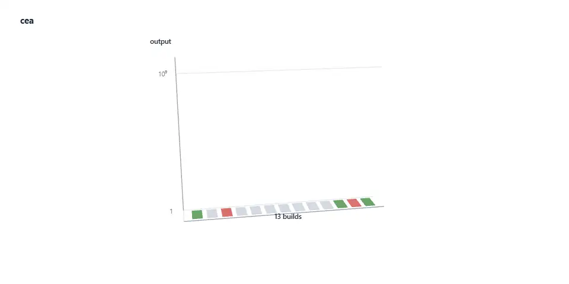

# cea

Makes coding agents prove compiler claims.



<sub>A replay of the recorded run in `examples/05-ub-sanitizers-cannot-see` (clang 23.1.5), following the halving loop in `src/tools/bisect_passes.ts`. Not re-run here. The verdict was undefined behaviour in the program, not a compiler bug.</sub>

<picture>
  <source media="(max-width: 600px) and (prefers-color-scheme: dark)" srcset=".github/assets/rule-mobile-01-dark.svg">
  <source media="(max-width: 600px)" srcset=".github/assets/rule-mobile-01-light.svg">
  <source media="(prefers-color-scheme: dark)" srcset=".github/assets/rule-01-dark.svg">
  
</picture>

cea (Compiler Engineering Agent) gives a coding agent the tools a compiler engineer uses: compile,
inspect IR, check for undefined behaviour, compare optimisation levels, find the pass that changed
the result, shrink the test case and check a transformation with Alive2. It runs the compilers you
already have. Every call returns one evidence record that says what was observed, what was inferred
and what is still unknown, so a claim like "this is a compiler bug" has to cite proof.

It ships as an MCP server, a CLI (`cea`) and an agent skill. It is a prototype at version 0.1.0.
It has been run against real clang and GCC by its author and in CI, but several paths were only
tested with fakes, and it has never confirmed a real miscompile.

<picture>
  <source media="(max-width: 600px) and (prefers-color-scheme: dark)" srcset=".github/assets/rule-mobile-02-dark.svg">
  <source media="(max-width: 600px)" srcset=".github/assets/rule-mobile-02-light.svg">
  <source media="(prefers-color-scheme: dark)" srcset=".github/assets/rule-02-dark.svg">
  
</picture>

**The problem.** A program prints one answer at `-O0` and another at `-O2`. The quick conclusion is
"miscompile". Often it is undefined behaviour in the program, which lets the optimiser do anything.
A wrong bug report costs a compiler maintainer time. A wrong compiler rewrite breaks other people's
programs. Coding agents can produce both with confidence.

**What was missing.** A way for an agent to reach the real tools (sanitizers, `-opt-bisect-limit`,
reducers, Alive2, llvm-mca) and to keep what it found as citable records instead of prose. The
design follows three rules from [`docs/design.md`](docs/design.md): semantics before speed, evidence
before claims, small before large.

**Who it is for.** People who use a coding agent on compiler work: triaging a suspected miscompile,
asking why a loop was not vectorised, checking a peephole rewrite, or reducing a compiler crash.

<picture>
  <source media="(max-width: 600px) and (prefers-color-scheme: dark)" srcset=".github/assets/rule-mobile-03-dark.svg">
  <source media="(max-width: 600px)" srcset=".github/assets/rule-mobile-03-light.svg">
  <source media="(prefers-color-scheme: dark)" srcset=".github/assets/rule-03-dark.svg">
  
</picture>

1. **Request.** An agent calls a tool over MCP on stdio (`cea mcp`), or a person runs
   `cea <tool> --json '<input>'`. Both read the same tool list in `src/registry.ts`, so they cannot drift.
2. **Validate.** Input is checked against a strict zod schema. Flags that make the compiler load other
   code (`-fplugin`, `-load`, `-B`, `-specs`, response files) are refused unless
   `CEA_ALLOW_UNSAFE_FLAGS=1`.
3. **Find providers.** The toolbox looks for 19 providers (clang, GCC, rustc, opt, llc, llvm-reduce,
   llvm-mca, alive-tv, cvise, Csmith, git and others) in `CEA_TOOL_<NAME>`, next to clang,
   in `CEA_TOOLCHAIN_DIRS` and on `PATH`. Nothing is bundled, installed or downloaded.
4. **Run.** Every process starts from an argument array with no shell, a timeout and an output cap.
   Compiled test programs run with a scrubbed environment in a per-call work directory.
5. **Record.** The result becomes an evidence record: exact commands, tool versions, target triple,
   SHA-256 of inputs, observed, inferred, unknowns, limitations and coverage. It is appended to
   `.cea/sessions/<session>/evidence.jsonl`. Large output stays on disk as views, read page by page.
6. **Cite.** Later calls refer to earlier records by id. `triage_miscompile` chains the steps and
   stops as soon as the question is answered.

No network is used by default. The one remote feature sends IR to the Alive2 project's Compiler
Explorer instance, and only when `CEA_REMOTE_PROVIDERS=compiler-explorer` is set.

A terminal recording of `cea triage` on example 1 is in [`docs/demo/triage.gif`](docs/demo/triage.gif).

<picture>
  <source media="(max-width: 600px) and (prefers-color-scheme: dark)" srcset=".github/assets/rule-mobile-04-dark.svg">
  <source media="(max-width: 600px)" srcset=".github/assets/rule-mobile-04-light.svg">
  <source media="(prefers-color-scheme: dark)" srcset=".github/assets/rule-04-dark.svg">
  
</picture>

What the code does today. Each of the 20 tools is both an MCP tool and a CLI command.

- **Environment.** `environment_report`: providers found, versions, targets, which sanitizers link,
  and a fix for each missing one. `src/tools/environment_report.ts`, `src/core/toolbox.ts`
- **Compile and inspect.** `compile`, `emit_ir`, `pass_timeline` (what each pass did to one function),
  `opt_remarks` (what the optimiser declined and why). `src/tools/`
- **Correctness.** `check_ub` (UBSan, ASan, MSan, Miri), `differential_run`, `bisect_passes`
  (`-opt-bisect-limit`), `reduce_testcase` (cvise, creduce, llvm-reduce or a built-in line reducer),
  `validate_transform` (Alive2), `fuzz_compiler` (Csmith or YARPGen), `bisect_compiler_history`
  (`git bisect run`). `src/tools/`
- **Performance.** `analyze_throughput` (llvm-mca) and `benchmark` (warm-up, at least 5 runs, median
  and spread, outputs must match). `src/tools/`
- **Triage.** `triage_miscompile` runs environment, UB check, differential run, pass bisection,
  reduction, pass timeline and Alive2 in order, stops early, and drafts a bug report in Markdown.
  Verdicts include `undefined_behavior`, `not_reproduced`, `suspected_undetected_ub` and
  `transformation_refuted`. `src/tools/triage_miscompile.ts`
- **Ledger.** `inspect_evidence_view`, `list_evidence`, `record_unknown`, `update_unknown`,
  `export_evidence_bundle`. `src/core/ledger.ts`, `src/tools/ledger_tools.ts`
- **Agent skill.** `compiler-engineering` with seven reference guides, copied into place by
  `cea install-skill`. `skills/compiler-engineering`

Five worked examples with output recorded on the author's machine (clang 23.1.5, Windows 11),
from the example READMEs:

| Example | Case | Recorded result |
|---|---|---|
| [01](examples/01-ub-not-a-compiler-bug/README.md) | "Compiler bug" that is signed overflow | Stops at step 2: UB at `overflow.c:3`, not a compiler bug |
| [02](examples/02-missed-vectorization-aliasing/README.md) | Missed vectorisation from aliasing | Remark explains it; with `restrict` 3.55x faster by median, same output |
| [03](examples/03-alive2-counterexample/README.md) | Wrong InstCombine-style rewrite | Alive2 counterexample, through the remote provider |
| [04](examples/04-crash-reduction/README.md) | Constructed clang crash, 88 lines | Reduced to 2 lines under a crash-signature test |
| [05](examples/05-ub-sanitizers-cannot-see/README.md) | Strict-aliasing UB that sanitizers miss | Full chain runs; compiler bug "unlikely" |

Known limits, from [`PROGRESS.md`](PROGRESS.md) and the code:

- The "likely compiler bug" verdict has never fired on a real miscompile. It is covered by logic and
  unit tests only.
- The Rust paths (rustc `emit_ir`, Miri), YARPGen, MSan and a local `alive-tv` binary were never run
  against the real tools. `bisect_compiler_history` was never run on a real compiler checkout.
- Running a test program executes its code. The scrubbed environment and timeouts limit accidents;
  they are not a sandbox. See [`SECURITY.md`](SECURITY.md).
- A clean `check_ub` means no finding on the paths that ran. Pass bisection names where behaviour
  flips, not where the fault is. llvm-mca is a static model.
- `benchmark` times whole processes on one machine and reads no hardware counters.
- GCC support is narrower than LLVM: no IR validation and a flag scan instead of pass bisection.
- The skill's reference guides have not been reviewed by a compiler engineer.

<picture>
  <source media="(max-width: 600px) and (prefers-color-scheme: dark)" srcset=".github/assets/rule-mobile-05-dark.svg">
  <source media="(max-width: 600px)" srcset=".github/assets/rule-mobile-05-light.svg">
  <source media="(prefers-color-scheme: dark)" srcset=".github/assets/rule-05-dark.svg">
  
</picture>

Requires Node 20 or newer, plus whichever compilers you want cea to drive. Commands below were run on
Windows 11 with Node 26.13.0 and npm 11.20.0. No compiler was installed on that machine, so only the
compiler-free steps produced results. macOS and Linux were not tried there; CI runs the unit tests
on all three.

```bash
git clone https://github.com/hesselb20-ctrl/cea.git
cd cea
npm ci
npm run build
```

Typecheck, lint and run the unit tests (providers are mocked). Expect no errors from the first two
and `111 passed`.

```bash
npm run typecheck
npm run lint
npm run test:unit
```

Integration tests need real compilers. A test whose provider is missing is skipped, not failed. With
no compiler installed the result was `6 passed | 24 skipped (30)`.

```bash
npm run test:integration
```

See what cea can find. It reported `1/19 providers available`: git was found, every compiler was
missing, each with a fix line.

```bash
node dist/cli.js doctor
```

List the 20 tools.

```bash
node dist/cli.js tools
```

Without clang, `node dist/cli.js triage examples/01-ub-not-a-compiler-bug/overflow.c` stops with
`clang is not available` and exit code 2. With clang installed it should print the run in the
linked recording; that was not run here.

The package is also on npm as `cea-agents` 0.1.0 (`npm install -g cea-agents`). That install,
`cea mcp` with an agent and `cea install-skill` were not run here. Agent setup and environment
variables: [connection and recovery](skills/compiler-engineering/references/connection-and-recovery.md).

<picture>
  <source media="(max-width: 600px) and (prefers-color-scheme: dark)" srcset=".github/assets/rule-mobile-06-dark.svg">
  <source media="(max-width: 600px)" srcset=".github/assets/rule-mobile-06-light.svg">
  <source media="(prefers-color-scheme: dark)" srcset=".github/assets/rule-06-dark.svg">
  
</picture>

**Stack**

| Layer | Built with |
|---|---|
| Language | TypeScript, ESM, Node 20+ |
| Runtime dependencies | `@modelcontextprotocol/sdk`, `zod` |
| Storage | JSONL files and raw output views on disk, no database |
| External tools | Whatever is installed: clang, GCC, LLVM tools, rustc, alive-tv, cvise, creduce, Csmith, YARPGen, git |
| Tests | Vitest, ESLint, GitHub Actions |

**Status**

| Part | State |
|---|---|
| 20 tools, MCP server, CLI | Built. Unit tests pass with mocked providers. |
| clang and GCC paths | Run by the author on Windows with clang 23.1.5 and GCC 16.2. Integration tests run on Ubuntu in CI. |
| Rust, Miri, MSan, YARPGen, local alive-tv | Written from the tools' documentation. Tested with fakes only. |
| Alive2 | Run through the remote provider only (examples 3 and 5). |
| Compiler bug detection | Never confirmed on a real miscompile. |
| Skill and reference guides | Written. Not reviewed by a compiler engineer. |
| Release | Tag `v0.1.0`. Package `cea-agents` 0.1.0 on npm. |

**Roadmap.** The repository lists open items, not a plan. From [`CHANGELOG.md`](CHANGELOG.md) and
[`PROGRESS.md`](PROGRESS.md):

1. Exercise Rust (rustc `emit_ir`, Miri), YARPGen, MSan and a local `alive-tv` against the real tools.
2. Extend the Compiler Explorer provider beyond `validate_transform`; remote compilation is not implemented.
3. Read hardware counters in `benchmark`.

**Documents**

| File | Contents |
|---|---|
| [`docs/design.md`](docs/design.md) | Components, evidence schema, provider interface, safety model, risks |
| [`docs/cli.md`](docs/cli.md) | Command-line reference |
| [`docs/triage.md`](docs/triage.md) | The triage chain, stop conditions and verdicts |
| [`docs/tools-environment.md`](docs/tools-environment.md), [`docs/tools-compile.md`](docs/tools-compile.md), [`docs/tools-correctness.md`](docs/tools-correctness.md), [`docs/tools-performance.md`](docs/tools-performance.md), [`docs/tools-ledger.md`](docs/tools-ledger.md) | One page per tool family |
| [`PROGRESS.md`](PROGRESS.md) | What was verified, how, and what was not |
| [`SECURITY.md`](SECURITY.md) | What running a test program means, and how to report a vulnerability |
| [`CONTRIBUTING.md`](CONTRIBUTING.md), [`CHANGELOG.md`](CHANGELOG.md) | Development and changes |
| [`skills/compiler-engineering/SKILL.md`](skills/compiler-engineering/SKILL.md) | The agent skill |

<picture>
  <source media="(max-width: 600px) and (prefers-color-scheme: dark)" srcset=".github/assets/rule-mobile-07-dark.svg">
  <source media="(max-width: 600px)" srcset=".github/assets/rule-mobile-07-light.svg">
  <source media="(prefers-color-scheme: dark)" srcset=".github/assets/rule-07-dark.svg">
  
</picture>

MIT. See [`LICENSE`](LICENSE).
