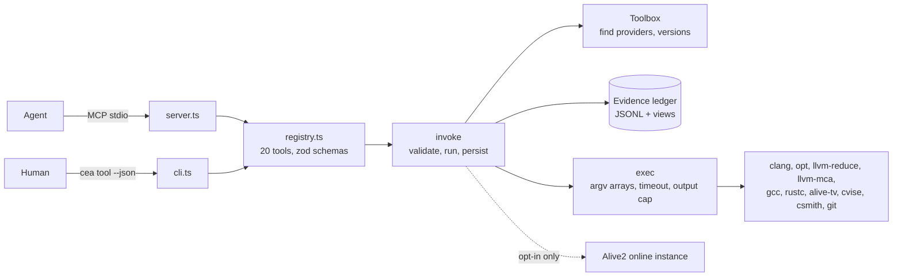

<p align="center"></p>

# cea: Compiler Engineering Agent

**Give your coding agent a compiler engineer's toolbox — and make it prove every claim.**

cea is an MCP server, a CLI and an agent skill. It wraps the compiler tools you already have (clang, opt, llvm-reduce, llvm-mca, GCC, rustc, Alive2, cvise, Csmith), stores every result as a citable **Evidence record**, and teaches the agent a workflow in which "compiler bug", "this pass is correct" and "this is faster" are things you say only with proof.

Three rules run through all of it:

1. **Semantics before speed.** A faster program with a different answer is a bug.
2. **Evidence before claims.** Every conclusion cites evidence IDs and separates observed, inferred and unknown.
3. **Small before large.** Reduce the test case, then reason about it.

One wrong compiler rewrite breaks everyone's programs. One wrong "it's a compiler bug" wastes a maintainer's day. Agents are fluent at both. cea makes them slow down in the right places.

## 30-second quickstart

Requires Node 20 or newer, and whichever compilers you want to use. cea never installs or downloads a compiler.

```sh
npm install -g cea-agents    # the `cea` command
cea doctor                   # what was found, what is missing, how to fix it
cea triage examples/01-ub-not-a-compiler-bug/overflow.c
```

Give it to your agent (Claude Code shown; any MCP client with stdio works):

```sh
claude mcp add cea -- cea mcp     # the MCP server
cea install-skill                 # the skill, into ~/.claude/skills/compiler-engineering
```

The npm package is [`cea-agents`](https://www.npmjs.com/package/cea-agents); without a global install, `npx -y cea-agents <command>` works too. Setup for other clients, environment variables and troubleshooting: [connection and recovery](skills/compiler-engineering/references/connection-and-recovery.md).

## What it looks like

A program prints `0` at `-O0` and `1` at `-O2`. The agent's first instinct is "miscompile". The demo above is that case, recorded from a real run ([cast](docs/demo/triage.cast)):

```
$ cea triage examples/01-ub-not-a-compiler-bug/overflow.c
  [1] environment        ok  9/19 providers available; compilers: clang (x86_64-w64-windows-gnu), ...
      evidence ev_environment_report_84b6d483
  [2] check_ub           ok  UB found: signed integer overflow: 2147483647 + 1 cannot be represented
                             in type 'int' at overflow.c:3
      evidence ev_check_ub_6a29004c

  verdict: undefined_behavior
  UB found at overflow.c:3:36 (signed integer overflow ...), not a compiler bug
  compiler bug? no
```

Seven steps were available; it stopped after two, because the question was answered.

## Tools

Every tool is an MCP tool and a CLI command: `cea <tool> --json '<input>'` or `cea <tool> --input file.json`. Each call returns one Evidence record.

| Tool | What it does | Docs |
|---|---|---|
| `environment_report` | Detected compilers, versions, targets, providers, and why any are unavailable | [environment](docs/tools-environment.md) |
| `compile` | Compile with exact flags; asm, IR, object or executable, diagnostics, timing | [compile](docs/tools-compile.md) |
| `emit_ir` | Frontend-only IR, before any pass ran (clang, rustc MIR and LLVM IR, GCC GIMPLE) | [compile](docs/tools-compile.md) |
| `pass_timeline` | What each pass did to one function, as paged diffs, no-op passes skipped | [compile](docs/tools-compile.md) |
| `opt_remarks` | Optimisation remarks and missed-optimisation reasons, grouped by function and loop | [compile](docs/tools-compile.md) |
| `check_ub` | UBSan, ASan, MSan or Miri at -O0 and -O1; findings with source locations | [correctness](docs/tools-correctness.md) |
| `differential_run` | Same program across compilers and optimisation levels; compares output and exit codes | [correctness](docs/tools-correctness.md) |
| `bisect_passes` | Binary search over `-opt-bisect-limit`; the first pass that flips the behaviour | [correctness](docs/tools-correctness.md) |
| `reduce_testcase` | Strict interestingness test plus cvise, creduce, llvm-reduce or a built-in reducer | [correctness](docs/tools-correctness.md) |
| `validate_transform` | Alive2 on before/after IR; pass or fail with the counterexample | [correctness](docs/tools-correctness.md) |
| `fuzz_compiler` | Time-boxed Csmith or YARPGen differential campaign; every divergence saved with its seed | [correctness](docs/tools-correctness.md) |
| `bisect_compiler_history` | `git bisect run` on a compiler checkout with a reduced test | [correctness](docs/tools-correctness.md) |
| `analyze_throughput` | llvm-mca on a loop or function for a named CPU, with its limits stated | [performance](docs/tools-performance.md) |
| `benchmark` | Warm-up, repeated runs, median and spread, machine info, output-correctness check | [performance](docs/tools-performance.md) |
| `triage_miscompile` | The whole chain in one call, with early stops and a draft bug report | [triage](docs/triage.md) |
| `inspect_evidence_view` | Read a record, or page through its raw output without flooding the context | [ledger](docs/tools-ledger.md) |
| `list_evidence` | Evidence IDs in the session | [ledger](docs/tools-ledger.md) |
| `record_unknown`, `update_unknown` | Track open questions with supporting and contradicting evidence IDs | [ledger](docs/tools-ledger.md) |
| `export_evidence_bundle` | The whole session as one portable file, for a bug report | [ledger](docs/tools-ledger.md) |

Command-line reference: [docs/cli.md](docs/cli.md).

## The Evidence record

```jsonc
{
  "evidence_id": "ev_check_ub_6a29004c",        // cite this
  "operation": "check_ub",
  "status": "ok",                               // ok | inconclusive | unavailable | error
  "summary": "UB found: signed integer overflow ... at input.c:3",
  "input_files": [{ "path": "...", "sha256": "...", "bytes": 164 }],
  "tools": [{ "name": "clang", "path": "...", "version": "clang version 23.1.5 ..." }],
  "commands": [{ "argv": ["clang", "-O0", "-g", "-fsanitize=undefined,address", "..."], "exit_code": 0, "duration_ms": 212 }],
  "target_triple": "x86_64-w64-windows-gnu",
  "result": { "clean": false, "findings": [{ "sanitizer": "ubsan", "line": 3, "column": 36, "message": "..." }] },
  "observed": ["ubsan: signed integer overflow ... at input.c:3:36 (-O0)"],
  "inferred": ["The program executes undefined behaviour, so differing output ... is not evidence of a compiler bug."],
  "unknowns": [],
  "limitations": ["Sanitizers only see undefined behaviour on the paths this input executed ..."],
  "coverage": { "opt_levels": ["O0", "O1"], "sanitizers_run": ["undefined", "address"] },
  "views": [{ "name": "04-run_O0-undefined_address.stderr.txt", "lines": 2, "sha256": "..." }]
}
```

Records live in a local session directory (JSONL plus raw output files). Later calls refer to earlier ones by ID. Large outputs stay on disk and are paged with `inspect_evidence_view`. Failures are records too: "alive-tv is not installed" is a fact the agent has to report, not work around.

## Example prompts

With the server connected and the skill installed:

- "This prints 0 at -O0 and 1 at -O2. Is it a compiler bug? `examples/01-ub-not-a-compiler-bug/overflow.c`"
- "Why isn't the loop in `scale()` vectorised, and is fixing it actually faster? Show the spread."
- "I want to add a peephole that turns `(x + 1) > x` into `true`. Check it with Alive2 before I write the code."
- "clang crashes on `crash.c`. Reduce it and tell me the crash signature."
- "Sanitizers are clean but -O2 still gives a different answer. Go through the whole triage and tell me what is observed, inferred and unknown."
- "Fuzz clang against gcc for two minutes and save anything that diverges."

## Examples

Five small cases with the real output of a recorded run, each reproducible with one command:

| | Case | Outcome |
|---|---|---|
| [01](examples/01-ub-not-a-compiler-bug/README.md) | "Compiler bug" that is signed-overflow UB | cea stops at step 2: UB at `overflow.c:3`, not a compiler bug |
| [02](examples/02-missed-vectorization-aliasing/README.md) | Missed vectorisation caused by aliasing | remark: "uncountable loop"; with `restrict` 3.55x faster, ranges do not overlap, same output |
| [03](examples/03-alive2-counterexample/README.md) | A wrong InstCombine-style rewrite | Alive2 counterexample at `x = 2147483647`; correct once `nsw` is required |
| [04](examples/04-crash-reduction/README.md) | A clang crash in an 88-line file | reduced to 2 lines under a crash-signature test |
| [05](examples/05-ub-sanitizers-cannot-see/README.md) | UB that sanitizers cannot see (strict aliasing) | full chain runs; verdict "suspected undetected UB", compiler bug "unlikely" |

The numbers come from one machine and one compiler version, stated in each example. Yours will differ.

## Architecture



- One tool definition serves both the MCP server and the CLI.
- Providers are thin adapters. They are found on `PATH`, in `CEA_TOOLCHAIN_DIRS`, or through `CEA_TOOL_<NAME>`; nothing is bundled or installed.
- Every process is started with an argument array and no shell, with a timeout and an output cap.
- No network by default. The single remote feature sends the IR being checked to the Alive2 project's online instance, and only if `CEA_REMOTE_PROVIDERS=compiler-explorer` is set.

Design notes: [docs/design.md](docs/design.md).

## Limitations

Read these before trusting a result.

- **Running a test program executes its code.** Test programs get a scrubbed environment, a timeout and an output cap, in a per-call work directory. That limits accidents. It is not a sandbox. See [SECURITY.md](SECURITY.md).
- **Sanitizers are not proof.** A clean `check_ub` means no finding on the paths that ran. Strict-aliasing violations, unsequenced modifications and most uninitialised reads are invisible to it. Example 5 exists to make this concrete.
- **Alive2 is bounded** (loop unrolling, one function at a time, approximated memory and calls) and does not model type-based aliasing. `validate_transform` is unavailable without `alive-tv` unless you opt into the remote provider.
- **Pass bisection names where behaviour flips, not where the fault is.**
- **llvm-mca is a static model**: no caches, no branch misprediction, no frontend effects.
- **`benchmark` measures wall-clock time of whole processes** on one machine with one input. It is not pinned to a core and does not read hardware counters; perf is detected but not used yet.
- **The built-in reducer removes whole lines only.** Install cvise for real reductions.
- **Coverage of this release.** Developed and run on Windows 11 with clang 23.1.5 (llvm-mingw) and GCC 16.2; CI runs unit tests on Linux, macOS and Windows and integration tests on Ubuntu. Csmith fuzzing was run for real with Csmith 2.3.0. The Rust paths (rustc `emit_ir`, Miri in `check_ub`), YARPGen, MSan and a local `alive-tv` binary are implemented from the tools' documentation and unit-tested with fakes, but have not been run against the real tools. [PROGRESS.md](PROGRESS.md) lists exactly what was verified and how.
- GCC support is narrower than LLVM support: no IR validation, tree dumps only in `pass_timeline`, and a flag scan in place of pass bisection.

## Development

```sh
npm install
npm run build
npm run typecheck && npm run lint
npm run test:unit            # providers mocked; runs anywhere
npm run test:integration     # real compilers; a test whose provider is missing is skipped and reported
```

See [CONTRIBUTING.md](CONTRIBUTING.md). Changes: [CHANGELOG.md](CHANGELOG.md).

## License

[MIT](LICENSE)
